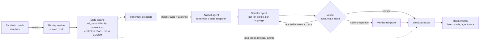

# Regista

**Real-time, explained and verified match intelligence, personalized for every fan.**

Regista reads a live stream of football events and turns it into broadcast-ready overlays. It works out *why* a
moment matters: a press that suddenly bites, a spell of chaos, a record sprint, a brace that is also a 50th career
goal. A team of agents then tells that story to each viewer in their own mode, club and language. Every number on
screen is checked against computed match data before it airs.

> Entry for *Inside the Game: Developer Hackathon* (Microsoft x Premier League). All clubs, players, venues and match
> data in this repository are fictional and synthetic.

## What it does

| Stage | In Regista |
| --- | --- |
| **Ingest** | A seeded simulator produces a football-realistic event stream (passes, carries, shots, pressures, tackles, possession changes, sprints) with player coordinates. A replay service streams it at any speed. |
| **Interpret** | A deterministic state engine computes pass difficulty, xG, momentum, control vs chaos and press intensity on every event, in about 25 µs. |
| **Explain** | Nine detectors fire on moments that matter (goals, big chances, key passes, momentum shifts, press changes, chaos spells, speed records, milestones, period summaries). Each fires with facts and evidence. |
| **Render** | Timed, prioritized, machine-readable `OverlayPayload`s over WebSocket, drawn by a React broadcast overlay with five graphics slots. |
| **Personalize** | Analyst, casual and player-focus modes; favourite club; focus player; metric of interest; English, Spanish and Hindi. The facts never change between viewers, only the telling. |

## Architecture



**Two tiers.** The *hot path* (state engine and detectors) is deterministic, tested and runs on every event with
no model in it. The *warm path* (agents) runs only on detected moments. Broadcast graphics already trail live action,
so a few seconds of narration latency are acceptable, and a verified template is always ready if a model is slow or
wrong.

**Facts before prose.** A detector emits one canonical `Insight` whose `facts` each carry evidence: event ids, or
metric keys with a time window. Every sentence a model writes must cite the facts it uses. The Verifier then checks
the sentence mechanically before it reaches a screen.

## The Verifier, and what a real model taught it

The Verifier is deliberately code: the gate that keeps ungrounded claims off screen must not be able to hallucinate.
For every sentence it checks:

- **Citations:** every cited fact id exists in the insight.
- **Numbers:** each one equals a cited fact's value, previous value, or a number inside it (score, clock, window
  length). Number words count too: "his **second** goal", "only **one** shot", "segundo gol".
- **Attribution:** a number taken from a fact about Northvale must say it is about Northvale.
- **Entities:** only players and teams that belong to the moment may be named.
- **Language:** Hindi must be in Devanagari, and Spanish must not drift into English, Portuguese or another script.
- **Shape:** no placeholders, and overlay length limits are respected.

A rejected draft goes back to the Narrator once, with the reasons. A second failure falls back to a verified template,
and the trace records why. Most of these rules came from real drafts written by a local `qwen2.5:3b` model. For
example, it wrote "Vukovic anota el **segundo** gol" for a first goal, put Vukovic in the wrong club, and answered a
Spanish viewer in Portuguese. All three were blocked. See [D28](docs/DECISIONS.md) for the full list, and for what a
mechanical check cannot catch.

## Measured results

| What | Result |
| --- | --- |
| Hot path latency (seed 7, 2,406 events) | about 70 ms for the whole match; p95 under 0.05 ms per event |
| Pass difficulty model (fitted on seeds 1-5, tested on 7) | Brier 0.129 vs 0.165 for a constant rate; calibration within 0.03 in every bin |
| xG model (same split) | expected Brier 0.136 vs 0.163 for mean xG |
| Planted storylines and scripted moments (seeds 1-5 and 7) | all acceptance tests pass: 3 goals, brace milestone, record sprint, press change in 58-66' with none before 55', chaos spell |
| Held-out seeds 8-25 (never tuned on) | 15 of 18 pass every criterion; all 3 misses are press-change timing (see [D18](docs/DECISIONS.md)) |
| Recorded agent run (`data/RGS-2026-0001.renders.json`) | 31 renders: 15 by the model and verified, 6 verified templates after rejected drafts, 10 Hindi templates by configuration |
| Tests | 216 backend (pytest), 9 frontend (Vitest); CI also fails on stale generated contracts |

## Run it locally

You need Python 3.11+ and Node 20+.

```bash
# backend (first time)
cd backend
python -m venv .venv
.venv\Scripts\activate                     # macOS/Linux: source .venv/bin/activate
pip install -e ".[dev,agents,api]"

# frontend (first time)
cd ../frontend
npm install
```

Start both (two terminals), then open <http://localhost:5173>:

```bash
cd backend && python -m regista.api        # replay API + WebSocket on :8000
cd frontend && npm run dev                 # overlay app on :5173, proxies /api and /ws
```

The match replays at 10× speed. Seek with the slider (37', 60' and 87' are good moments), switch viewers with the
profile presets, open **Compare viewers** for one moment told two ways, and click any graphic to see its agent trace.

**Choose the narration** in `backend/.env` (copy `.env.example`):

| Setting | What you get |
| --- | --- |
| `REGISTA_LLM_PROVIDER=none` | Verified templates only, instant, no model needed |
| `REGISTA_AGENT_CACHE=../data/RGS-2026-0001.renders.json` | The recorded model run, with its real Verifier rejections in the trace (best for a demo) |
| `REGISTA_LLM_PROVIDER=openai_compat` + `OPENAI_BASE_URL` / `OPENAI_MODEL` | Live narration from any OpenAI-compatible model, e.g. Ollama |
| `REGISTA_LLM_PROVIDER=foundry` + `FOUNDRY_PROJECT_ENDPOINT` / `FOUNDRY_MODEL` | Microsoft Foundry through Agent Framework (`az login`) |

`REGISTA_LLM_LANGUAGES=en,es` limits model narration to languages you have validated; the rest use templates.
`REGISTA_LLM_TIMEOUT_S` raises the per-call budget for slow local models.

**One service, as deployed:** `npm run build` in `frontend/`, then `python -m regista.api` serves the app and the API
together on <http://localhost:8000>.

### Other entry points

```bash
cd backend
python -m regista.detect ../data/RGS-2026-0001.json     # insight timeline + per-event latency
python -m regista.agents record ../data/RGS-2026-0001.json --out ../data/RGS-2026-0001.renders.json \
    --kinds goal,press_change,milestone,recap --profiles analyst-en,casual-es-slm --resume ../data/RGS-2026-0001.renders.json
python -m regista.sim generate --seed 7 --out ../data   # regenerate the demo match
python scripts/fit_models.py                            # refit pass / xG models, report vs ground truth
python scripts/hello_foundry.py                         # agent smoke test against the configured provider
```

## Repository layout

```text
backend/regista/
  contracts/   Pydantic contracts, the single source of truth: events, Insight, OverlayPayload, FanProfile, stream protocol
  sim/         seeded simulator with planted storylines and ground truth
  state/       hot-path metrics: rolling windows, pass difficulty, xG, momentum, control vs chaos, press CUSUM, records
  detect/      nine moment detectors and the insight pipeline (cooldowns, dedupe, deterministic ids)
  agents/      Analyst, Narrator, Verifier, template narration (en/es/hi), profiles, recaps, warm-path orchestration
  api/         FastAPI replay service and WebSocket hub
  llm.py       provider factory: foundry, azure_openai, foundry_local, openai_compat, none
backend/scripts/   schema export, model fitting, agent smoke test
backend/tests/     storyline acceptance tests across six seeds, agents through Agent Framework's real loop, API
contracts/schema/  JSON Schemas exported from the Python contracts
frontend/src/      React + TypeScript overlay; contracts/ is generated from contracts/schema
data/              demo match (seed 7), ground truth, recorded agent run
docs/              decisions, plan, API protocol, hackathon brief
```

Contracts flow one way: Pydantic → JSON Schema → TypeScript. After changing a model run
`python backend/scripts/export_schemas.py` and `npm run contracts --prefix frontend`; CI fails if they drift.

## Synthetic data

The simulator is a seeded possession-chain model with continuous player positions, so pressure, pass difficulty and
shot quality emerge from geometry instead of being sampled. Organic shots never score; goals come from a script, so
the demo scoreline is fixed while chance quality stays realistic. A ground-truth file (true xG per shot, model
coefficients, scripted event ids) exists only to evaluate the analytics; the pipeline never reads it.

Planted storylines in the demo match (Northvale FC 2-1 Saltmere Athletic):

| When | Storyline | What Regista finds |
| --- | --- | --- |
| 0-25' | Northvale control the tempo | high control score, long possessions, low transition entropy |
| 25-40' | A chaotic spell | chaos index up from about 0.4 to about 0.85 |
| 38' | Nordgren through ball, Vukovic scores | goal, key pass with pass difficulty |
| 58-72' | Saltmere switch to a high press | press change with the CUSUM change-point and its start time |
| 64' | Lindqvist wins it high, Shapira scores | the press → turnover → goal chain, in one insight |
| 76' | Balogun sprints at 34.8 km/h | player tag, fastest sprint of the match |
| 72-90' | Northvale go long to beat the press | long-ball share up |
| 88' | Haddad cross, Vukovic header | brace and 50th career goal milestone |

Pitch coordinates are absolute metres (x 0-105, y 0-68); direction depends on period. `elapsed_s` is the monotonic
clock used for replay and windows; `match_clock_s` is the broadcast clock.

## Status

- [x] Contracts, simulator, state engine, detectors, agents, Verifier, recaps, replay API, React overlay
- [x] Live model runs (local Ollama) and a recorded demo run
- [ ] Microsoft Foundry run and Azure Container Apps deployment (`azd up`): pending an Azure subscription
- [ ] OpenTelemetry tracing to Application Insights

Out of scope: computer-vision auto-eventing from video (a future producer behind the same event contract), real club
or league data, multi-match scale.

## Docs

- [`docs/DECISIONS.md`](docs/DECISIONS.md): every non-obvious design choice, with the numbers behind it
- [`docs/API.md`](docs/API.md): REST and WebSocket protocol
- [`docs/PLAN.md`](docs/PLAN.md): build plan and status
- [`docs/HACKATHON.md`](docs/HACKATHON.md): brief, rubric and rules
- [`CLAUDE.md`](CLAUDE.md): working context for contributors and coding agents

## License

MIT. See [LICENSE](LICENSE).
