# Regista

**Real-time, explainable, personalized match intelligence for broadcast and streaming.**

Regista reads every synthetic match event as it happens, explains why moments matter, verifies every claim against match data, and renders broadcast-ready overlays and recaps personalized by club, player, viewing mode and language. Built on Microsoft Foundry, Microsoft Agent Framework and Azure Container Apps.

> Entry for *Inside the Game: Developer Hackathon* (Microsoft x Premier League). All clubs, players, venues and match data in this repository are fictional and synthetic.

## Architecture

```mermaid
flowchart LR
    SIM[Synthetic match simulator<br/>seeded, spatial, planted storylines] -->|event stream| ING[Ingest + replay clock]
    ING --> STATE[Match state engine<br/>pass difficulty, xG, momentum,<br/>control vs chaos, press change]
    STATE --> DET[Moment detectors]
    DET -->|Insight + facts + evidence| ORCH{{Agent orchestration<br/>Microsoft Agent Framework}}
    ORCH --> AN[Analyst agent<br/>tools over match state]
    AN --> NA[Narrator agent<br/>why it matters, per profile]
    NA --> VE[Verifier agent<br/>every claim cites a fact]
    VE -->|rejected| NA
    VE -->|OverlayPayload| WS[WebSocket]
    WS --> UI[React overlay + fan controls]
    STATE -.->|under 200 ms, no LLM| WS
```



Two tiers, by design:

| Tier | What runs | Latency budget | Why |
| --- | --- | --- | --- |
| Hot path | Deterministic metrics, moment detection, stat overlays | under 200 ms per event | Testable, no hallucination risk, no per-event model cost |
| Warm path | Analyst, Narrator, Verifier agents on detected moments only | 1.5 to 3 s per moment | Broadcast graphics already trail live action; narratives land around stoppages |

Every `Insight` carries facts with evidence references. Personalization never changes facts: each rendering cites the fact ids its sentences rely on, so the Verifier can check claims mechanically and the same facts appear in every language.

## Docs

- [`CLAUDE.md`](CLAUDE.md): working context for Claude Code and contributors
- [`docs/HACKATHON.md`](docs/HACKATHON.md): brief, rubric, submission rules
- [`docs/DECISIONS.md`](docs/DECISIONS.md): architecture decisions
- [`docs/PLAN.md`](docs/PLAN.md): build plan and status

## Repository layout

```text
backend/
  regista/contracts/   Pydantic contracts: events, insights, overlay payloads (source of truth)
  regista/sim/         Synthetic match simulator and CLI
  scripts/             Schema export, Foundry smoke test
  tests/               Simulator, storyline and contract-drift tests
contracts/schema/      JSON Schemas exported from the Python contracts
frontend/              React + TypeScript overlay (types generated from contracts/schema)
data/                  Generated synthetic match and ground-truth files
```

## Quickstart

```bash
cd backend
python -m venv .venv && source .venv/bin/activate      # Windows: .venv\Scripts\activate
pip install -e ".[dev,agents]"
pytest -q

# Generate the canonical demo match (seed 7) and print the storyline summary
python -m regista.sim generate --seed 7 --out ../data

# Prove the agent stack against your Foundry deployment
cp .env.example .env    # fill in FOUNDRY_PROJECT_ENDPOINT and FOUNDRY_MODEL
az login
python scripts/hello_foundry.py
```

Run the replay API (template narration unless an LLM provider is set in `backend/.env`):

```bash
pip install -e ".[dev,agents,api]"
python -m regista.api                      # http://127.0.0.1:8000/api/health, ws://127.0.0.1:8000/ws?profile=analyst-en
python -m regista.agents record ../data/RGS-2026-0001.json --out ../data/RGS-2026-0001.renders.json
REGISTA_AGENT_CACHE=../data/RGS-2026-0001.renders.json python -m regista.api   # serve a recorded run
```

Regenerate contracts after changing a model:

```bash
python backend/scripts/export_schemas.py
npm install --prefix frontend && npm run contracts --prefix frontend
```

CI fails if the committed schemas or generated TypeScript types drift from the Python models.

## Synthetic data

The simulator is a seeded possession-chain model with continuous player positions, so pressure, pass difficulty and shot quality emerge from geometry rather than being sampled directly.

- **Movement.** 22 players relax towards a 4-3-3 shape that shifts with the ball (time constant about 1.8 s). Out of possession, the `1 + round(2 * press)` nearest defenders close the ball down to a distance that shrinks as pressing intensity rises.
- **Passes.** Completion is Bernoulli with `logit p = 3.6 - 0.075 L - 0.55 n_passer - 0.35 n_receiver - 0.6 [high] + skill`, where `L` is length in metres and `n` counts opponents within 5 m.
- **Shots.** Ground-truth xG is logistic in distance, goal-mouth angle, header flag and nearby defenders. Organic shots never score; goals come only from the script, so the scoreline is fixed while chance quality stays realistic.
- **Speeds.** Pass ball speed, shot speed, carry top speed and sprint events (distance, peak speed) are emitted for threshold-based player tagging.
- **Determinism.** One seeded RNG drives everything: same seed, same match.

Output per match: `data/<match_id>.json` (metadata and ordered events, about 2,400 events) and `data/<match_id>.truth.json` (storylines, scripted event ids, per-shot true xG, model coefficients). The truth file is never streamed to the pipeline; it exists to evaluate the analytics layer.

### Planted storylines (demo match, seed 7)

Northvale FC 2-1 Saltmere Athletic.

| Window | Storyline | Signal the analytics layer should find |
| --- | --- | --- |
| 0 to 25' | Northvale control the tempo | High home completion, long sequences, low sequence entropy |
| 25 to 40' | A chaotic spell | Turnover rate up for both sides, long-ball share up |
| 38' | Goal: Nordgren through ball, Vukovic finishes | Key pass, shot quality |
| 58 to 72' | Saltmere switch to a high press | Away pressures per home pass roughly 2 to 4x baseline, home completion down |
| 64' | Goal: Lindqvist wins it high, Shapira scores | Press-to-goal causal chain |
| 76' | Balogun sprint at 34.8 km/h | Fastest run of the match, player tag threshold |
| 72' onward | Northvale go long to beat the press | Home long-ball share up |
| 88' | Goal: Haddad cross, Vukovic header, brace | Milestone |

Storyline tests run across six seeds to make sure each signal is real, not one lucky draw.

### Event coordinate and clock conventions

- Absolute pitch metres, `x` in [0, 105], `y` in [0, 68]. Northvale attack `x = 105` in the first half; use `attacks_right(meta, team_id, period)`.
- `t` is seconds into the period, stoppage included. `match_clock_s` is the broadcast clock (period 2 restarts at 2700). `elapsed_s` is monotonic playing time and is what replay and windowing use.

## Status

- [x] Event and overlay contracts, JSON Schema, generated TypeScript types
- [x] Synthetic simulator with planted storylines and ground truth
- [x] Foundry + Agent Framework smoke test
- [x] Match state engine and moment detectors (`backend/regista/state`, `backend/regista/detect`): pass difficulty and xG
      models fitted on seeds 1-5 (seed 7 Brier 0.129 vs 0.165 baseline for passes; expected Brier 0.136 vs 0.163 for xG),
      momentum EWMA, control vs chaos, PPDA-like press with a gated CUSUM change-point, speed records, milestones, nine
      detectors emitting evidence-backed `Insight`s. Seed 7 replay: 40 insights from 2,406 events in about 70 ms,
      p95 under 0.05 ms per event. Try `python -m regista.detect ../data/RGS-2026-0001.json` from `backend/`.
- [x] Analyst, Narrator, Verifier agents and recap (`backend/regista/agents`): Agent Framework agents with tools
      over a frozen match-state snapshot, a code Verifier with one feedback retry, and a verified template fallback in
      English, Spanish and Hindi. Tested through Agent Framework's real tool loop with a scripted model; first live
      Foundry run pending.
- [x] Replay API (`backend/regista/api`): shared replay clock, `/ws?profile=` stream of ticks, events and verified
      overlays, per-profile fan-out with caching, recorded runs for demos. Protocol in [`docs/API.md`](docs/API.md).
- [ ] React overlay and fan controls
- [ ] Azure Container Apps deployment with `azd up`, OpenTelemetry tracing

Out of scope for this submission: computer-vision auto-eventing from video (planned as a separate producer behind the same event contract), real club or league data, multi-match scale.

## License

MIT. See [LICENSE](LICENSE).
